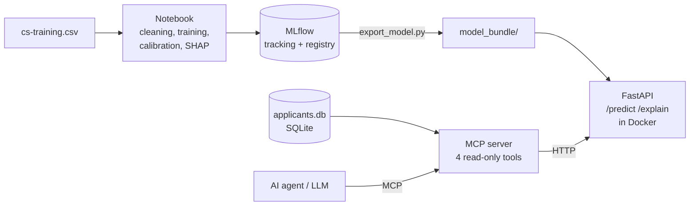
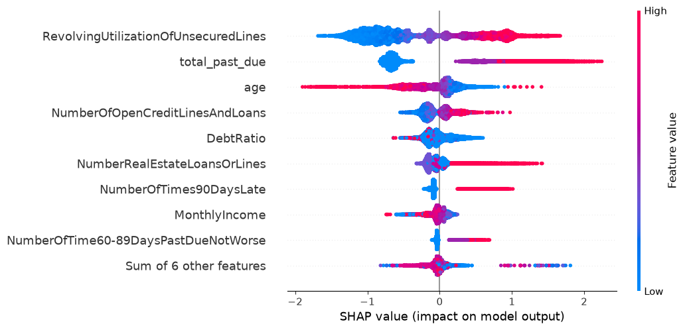
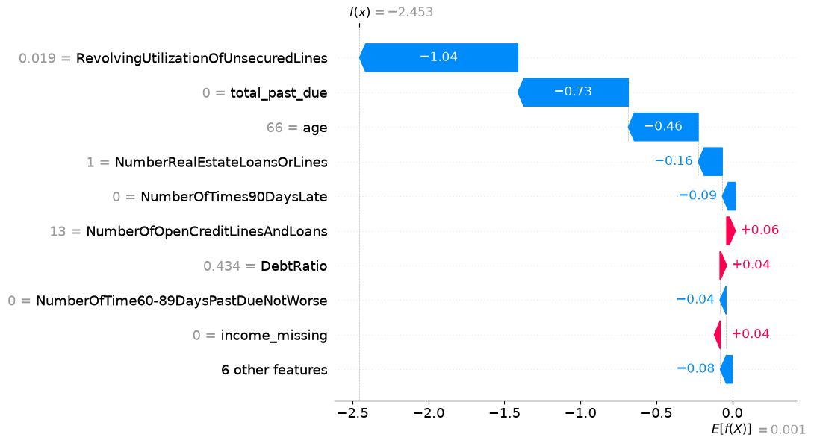

# AI-Powered Credit Scoring & MLOps

An end-to-end credit risk system: a calibrated **XGBoost** model that predicts whether a loan applicant will default, tracked and versioned with **MLflow**, served through a **FastAPI** REST API in **Docker**, with **SHAP** explanations for every decision and an **MCP server** that lets an AI agent analyse applicants safely.

---

## What it does

Send the API an applicant's financial profile, and it returns:

- the **probability of default** within 2 years (calibrated, so 0.20 really means about 20%)
- a **risk level**: `low`, `medium` or `high`
- a **decision**: `approve` or `reject`, based on a business-cost threshold
- the **main reasons** behind the decision (SHAP), on request

```json
POST /predict
{"revolving_utilization": 0.45, "age": 41, "past_due_30_59": 0, "debt_ratio": 0.35,
 "monthly_income": 5400, "open_credit_lines": 8, "times_90_days_late": 0,
 "real_estate_loans": 1, "past_due_60_89": 0, "dependents": 2}

→ {"default_probability": 0.04, "risk_level": "low", "decision": "approve",
   "threshold": 0.165, "model_version": "1"}
```

---

## Architecture



| Component | Role |
|---|---|
| `preprocessing.py` | `CreditCleaner`: cleaning and feature engineering, learned on training data only |
| `exploration.ipynb` | Data analysis, model training and comparison, calibration, threshold choice, SHAP, MLflow logging |
| MLflow | Logs every experiment; registers the best model under the `champion` alias |
| `export_model.py` | Exports the champion model into `model_bundle/` so Docker does not need the MLflow database |
| `api/` | FastAPI service: input validation, prediction, explanation |
| `Dockerfile` | Packages the API and model into a portable image |
| `mcp_server/` | Exposes the data and the API as tools for an AI agent (Model Context Protocol) |
| `tests/` | 26 automated tests (pytest) |

---

## Data

[Give Me Some Credit](https://www.kaggle.com/c/GiveMeSomeCredit) (Kaggle): 150,000 borrowers, 10 features, target `SeriousDlqin2yrs` (serious delinquency within 2 years).

- Highly **imbalanced**: only 6.7% of borrowers default.
- Data issues handled: missing income (about 20%) and dependents, error codes 96/98 in the late-payment columns, extreme outliers (e.g. debt ratio of 329,664), an invalid age of 0.

> The dataset is not included in this repository. Download `cs-training.csv` from Kaggle and place it in the project root to retrain the model or rebuild the applicant database.

---

## Approach

1. **Cleaning** (`CreditCleaner`, a scikit-learn transformer): error codes replaced and flagged, outliers capped at the 99th percentile, missing values imputed with "was missing" indicators, two engineered features (`total_past_due`, `log_income_per_person`). All statistics are learned on the training set only, to avoid data leakage.
2. **Models**: logistic regression baseline, then XGBoost tuned with `RandomizedSearchCV` (optimising PR-AUC, suited to imbalanced data).
3. **Calibration**: isotonic calibration, so predicted probabilities match observed default rates.
4. **Decision threshold**: chosen on out-of-fold training predictions by minimising a business cost (approving a defaulter costs **5**, rejecting a good client costs **1**) → threshold **0.165**.
5. **Explainability**: SHAP values on the XGBoost model, for global importance and for individual decisions.

---

## Results (test set, 30,000 applicants)

| Metric | Logistic regression | **XGBoost (tuned + calibrated)** |
|---|---|---|
| ROC-AUC | 0.860 | **0.870** |
| Gini | 0.719 | **0.739** |
| KS | 0.561 | **0.585** |
| PR-AUC | 0.389 | **0.407** |
| Brier score | – | **0.049** |

With the 0.165 threshold, the model:

- catches **57%** of defaulters (recall), with 36% precision among rejected applicants
- reduces the business cost by **36%** compared with approving everyone (6,383 vs 10,025)
- is well calibrated: average predicted risk **6.70%** vs real default rate **6.68%**

Risk levels: `low` below the average default rate (6.7%), `medium` up to the threshold, `high` at or above the threshold (rejected).

| Global feature importance (SHAP) | One applicant's decision (SHAP) |
|---|---|
|  |  |

---

## API

Built with **FastAPI**, served by **Uvicorn**. Interactive documentation is available at `http://localhost:8000/docs` once the API is running.

| Endpoint | Method | Description |
|---|---|---|
| `/health` | GET | Status, model version and threshold |
| `/predict` | POST | Default probability, risk level and decision |
| `/explain?top_k=5` | POST | Same as `/predict`, plus the top factors behind the decision |

Inputs are validated with Pydantic: age must be 18–120, values cannot be negative, unknown fields are refused (HTTP 422). `monthly_income` and `dependents` may be `null` when unknown.

---

## MCP server (AI agent tools)

The MCP server lets an LLM analyse an applicant from just an ID, without direct access to the model or the database. It exposes 4 tools:

| Tool | Source |
|---|---|
| `get_applicant(applicant_id)` | Profile from `applicants.db` |
| `get_credit_history(applicant_id)` | Credit behaviour from `applicants.db` |
| `predict_credit_risk(applicant_id)` | Calls `POST /predict` |
| `explain_prediction(applicant_id, top_k)` | Calls `POST /explain` |

Design choices:

- **The LLM never handles raw numbers**: it only passes an ID, so it cannot mistype or invent values.
- **Read-only database access**: the agent cannot modify applicant data.
- **No target leakage**: the real outcome is never stored in the database.
- **The model decides, the LLM explains**: tool descriptions forbid overriding the model's decision.

---

## How to run

### 1. Run the API with Docker (recommended)

The trained model is already included in `model_bundle/`.

```bash
docker build -t credit-scoring-api .
docker run -p 8000:8000 credit-scoring-api
```

Open **http://localhost:8000/docs** and try `/predict`.

### 2. Run locally (Python 3.14)

```bash
python -m venv .venv
.venv\Scripts\activate            # Windows  (Linux/macOS: source .venv/bin/activate)
pip install -r requirements-dev.txt
```

Start the API with the bundled model:

```powershell
$env:MODEL_DIR="model_bundle"     # Linux/macOS: export MODEL_DIR=model_bundle
uvicorn api.main:app --reload
```

### 3. Try the MCP tools

Requires `cs-training.csv` and a running API:

```bash
python build_applicant_db.py          # creates applicants.db
python -m mcp_server.try_client 125   # calls the 4 tools for applicant 125
```

### 4. Retrain the model

Run `exploration.ipynb` (requires `cs-training.csv`). It logs experiments to MLflow and registers the new champion model. Then export it for the API:

```bash
python export_model.py
```

To browse experiments: `mlflow ui --backend-store-uri sqlite:///mlflow.db`.

---

## Tests

```powershell
$env:MODEL_DIR="model_bundle"     # Linux/macOS: export MODEL_DIR=model_bundle
pytest -q
```

26 tests covering:

- **Preprocessing** (6): no missing values after cleaning, error codes handled, outliers capped, training statistics reused on new data (no leakage)
- **API** (8): response format, riskier applicants score higher, invalid inputs rejected (age < 18, negative values, unknown fields), explanations sorted by importance
- **MCP server** (12): database built correctly without the target, read-only access, correct payload sent to the API, clear errors when an applicant is unknown or the API is down

---

## Project structure

```
├── api/
│   ├── main.py            # FastAPI app and endpoints
│   ├── schemas.py         # Pydantic input/output models
│   └── service.py         # Model loading, prediction, SHAP explanation
├── mcp_server/
│   ├── server.py          # MCP server with 4 tools
│   └── try_client.py      # Manual end-to-end test
├── model_bundle/          # Exported champion model, explainer and config
├── tests/                 # pytest suite
├── preprocessing.py       # CreditCleaner transformer
├── exploration.ipynb      # EDA, training, calibration, SHAP, MLflow
├── export_model.py        # MLflow registry → model_bundle/
├── build_applicant_db.py  # CSV → applicants.db (SQLite)
├── Dockerfile
├── requirements.txt       # API dependencies (used by Docker)
└── requirements-dev.txt   # Development and test dependencies
```

---

## Tech stack

Python · pandas · scikit-learn · XGBoost · SHAP · MLflow · FastAPI · Pydantic · Uvicorn · Docker · MCP · SQLite · pytest

---

## Roadmap

- [ ] CI with GitHub Actions (tests on every push, Docker build)
- [ ] LLM agent (LangGraph) using the MCP tools to write credit memos
- [ ] Streamlit interface for the agent
- [ ] Prediction logging and data drift monitoring
- [ ] Cloud deployment of the API

---

## Author

**Emna Mallek**, engineering student in Modeling and Data Science (MIndS), École Nationale d'Ingénieurs de Tunis.
